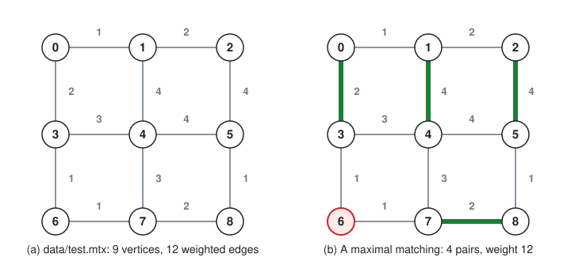
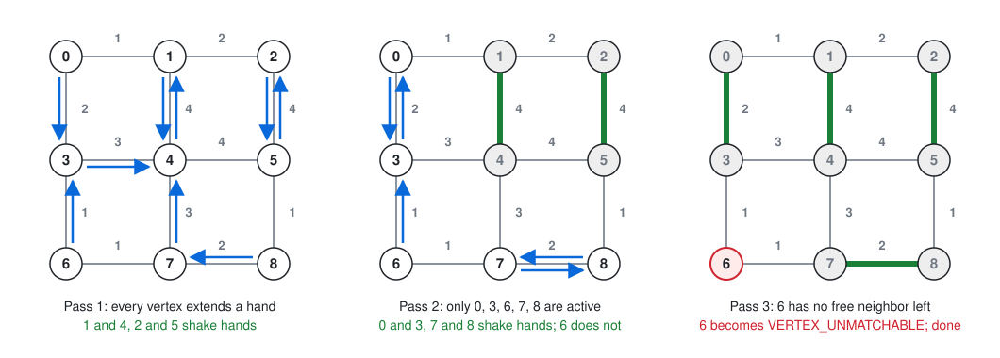
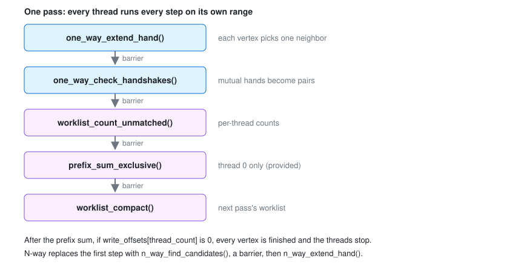
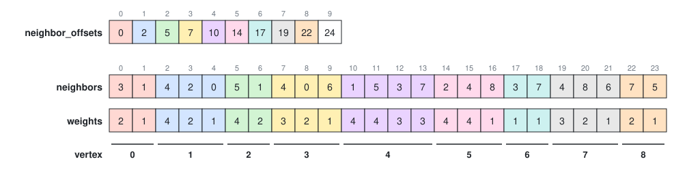
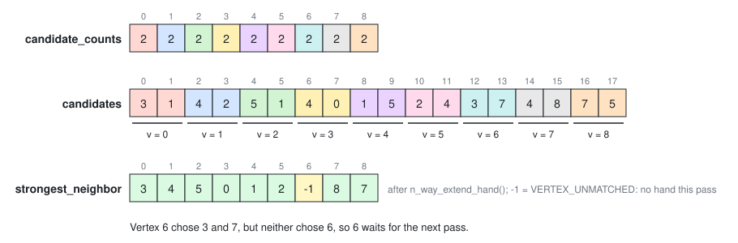
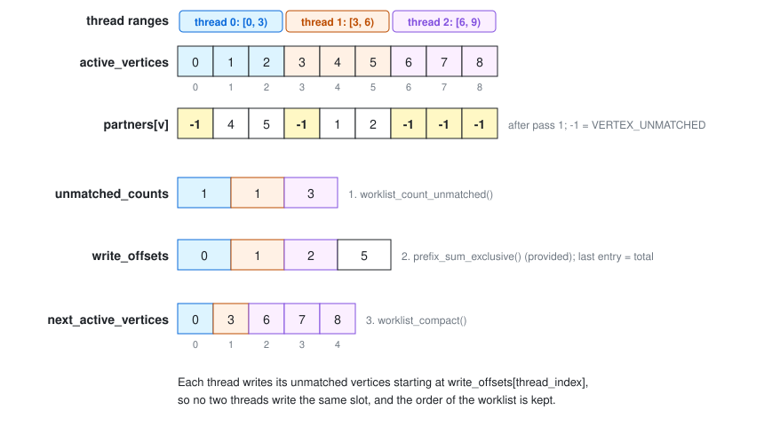

# Parallel Graph Matching by Handshaking

This guide describes the assignment in this repository: matching the vertices
of a large weighted graph in parallel, using POSIX threads and two
*handshaking* algorithms. It explains the algorithms, the data structures you
work with, each function you implement, and how to check your work.

## Contents

1. [Overview](#1-overview)
2. [Background](#2-background)
3. [The code you work with](#3-the-code-you-work-with)
4. [Splitting the work between threads](#4-splitting-the-work-between-threads)
5. [One-way handshaking](#5-one-way-handshaking)
6. [N-way handshaking (extra credit)](#6-n-way-handshaking-extra-credit)
7. [Removing finished vertices](#7-removing-finished-vertices)
8. [Building, running, and checking your work](#8-building-running-and-checking-your-work)
9. [Function reference](#9-function-reference)

## 1. Overview

You implement seven functions in three files. Everything else (reading
graphs, starting threads, synchronizing them, writing and checking results)
is provided.

| File | Functions | Section |
|------|-----------|---------|
| `components/handshake/src/worklist.c` | `worklist_range`, `worklist_count_unmatched`, `worklist_compact` | 4, 7 |
| `components/handshake/src/one_way.c` | `one_way_extend_hand`, `one_way_check_handshakes` | 5 |
| `components/handshake/src/n_way.c` | `n_way_find_candidates`, `n_way_extend_hand` (extra credit) | 6 |

Each function's contract is also in its header, under
`components/handshake/include/graph_matching/`.

You are done when:

- the assignment tests pass (section 8.2);
- `one-way` gives the same result as `greedy` on any graph (section 8.3);
- your results do not change with the number of threads.

## 2. Background

### 2.1 Graph matching

A graph *G = (V, E)* is a set of vertices *V* and a set of edges *E*, where
each edge joins two vertices. In a *weighted* graph, every edge also has a
weight. This assignment uses undirected weighted graphs.

A **matching** is a set of edges in which no two edges share a vertex. A
vertex is *matched* if one of the matching's edges touches it; the other end
of that edge is its *partner*.

- A matching is **maximal** if no edge can be added to it: every edge of the
  graph touches at least one matched vertex.
- The **weight** of a matching is the total weight of its edges.

Finding a matching of the largest possible weight is expensive, and hard to
do in parallel. The algorithms here instead find a maximal matching that
favors heavy edges, quickly, with many threads.

Figure 1(a) is the example graph used throughout this guide, `data/test.mtx`:
nine vertices in a grid, with weights from 1 to 4. Figure 1(b) shows a
maximal matching of it. Vertex 6 is left without a partner: both of its
neighbors are matched, so no edge can be added.



*Figure 1: (a) The example graph. (b) A maximal matching of weight 12.*

### 2.2 One-way handshaking

The algorithm runs in **passes**. In each pass:

1. Every vertex that is still unmatched **extends a hand** to its strongest
   unmatched neighbor: the one joined to it by the heaviest edge. Ties go to
   the neighbor with the smaller vertex ID.
2. Two vertices that extended their hands to each other **shake hands**, and
   become partners.

Vertices that did not shake hands try again in the next pass, now ignoring
the vertices that were matched. A vertex with no unmatched neighbor left
cannot be matched at all; it is marked *unmatchable* and drops out. The
passes stop when every vertex is matched or unmatchable.

Figure 2 shows the three passes on the example graph:

- **Pass 1:** vertex 1's strongest neighbor is 4 (weight 4), and 4's is 1
  (weight 4, which wins its tie with 5 because 1 < 5), so 1 and 4 shake
  hands. So do 2 and 5. Vertex 3 reaches for 4, but 4 is reaching for 1, so 3
  waits.
- **Pass 2:** with 1, 2, 4, and 5 matched, 0 and 3 now choose each other, and
  so do 7 and 8. Vertex 6 reaches for 3, which chose 0.
- **Pass 3:** both of 6's neighbors are matched, so 6 is unmatchable. Every
  vertex is now finished.



*Figure 2: One-way handshaking on the example graph. Arrows are hands;
matched edges are green.*

Within a pass, each vertex's decision depends only on its neighbors' state
from the previous pass, so every vertex can decide at the same time, on any
thread.

The result is always maximal, and it is exactly the matching that the
sequential **greedy** algorithm finds: take edges from heaviest to lightest
(ties by vertex ID), keeping each edge whose two endpoints are both still
free. The handshake only ever matches a pair whose edge greedy would take,
and in that case greedy takes it too. The program includes this greedy
algorithm, which gives you a correct answer to compare with (section 8.3).

### 2.3 N-way handshaking

In one-way handshaking, a vertex whose single hand is not returned makes no
progress that pass. N-way handshaking gives every vertex more chances per
pass:

1. Every unmatched vertex extends **N hands**, to its N strongest unmatched
   neighbors. These are its **candidates**.
2. Each vertex then keeps only its *mutual* candidates, the ones that also
   reached for it, and extends a single hand to the strongest of those.
3. Vertices whose single hands meet shake hands, as in one-way.

A vertex with candidates but no mutual candidate extends no hand this pass,
and waits for the next. A vertex with no candidates at all has no unmatched
neighbor, so it is unmatchable.

N-way finds the same kind of result as one-way (a valid, maximal matching),
but not always the same matching: the mutual-candidate rule can pair
vertices differently. On the example graph, 2-way handshaking finds the
matching in figure 1(b) in two passes instead of three.

### 2.4 Passes, threads, and barriers

The work in each pass is split across threads: each thread handles a range
of the vertices that are still active (section 4). Every thread runs every
step of the pass on its own range, and a **barrier** after each step makes
all threads wait until all of them have finished it. So when a step reads
another vertex's state, that state was written in an earlier step, by
whichever thread owned that vertex.



*Figure 3: The steps of one pass. Your functions are the steps; the driver
runs them and the barriers between them.*

Because of the barriers, and because each thread writes only its own
vertices' entries and its own per-thread slot, **no locks or atomic
operations are needed**. The driver in `components/handshake/src/handshake.c`
runs the loop shown in figure 3; you do not call barriers yourself.

## 3. The code you work with

### 3.1 The graph

`graph` (in `graph.h`) stores the graph as adjacency arrays:

| Field | Meaning |
|-------|---------|
| `vertex_count` | Number of vertices, numbered 0 to `vertex_count - 1` |
| `edge_count` | Number of undirected edges |
| `neighbor_offsets` | Where each vertex's neighbor list starts; `vertex_count + 1` entries |
| `neighbors` | All neighbor lists, one after another |
| `weights` | The weight of each entry in `neighbors` |

Every edge appears in both of its endpoints' lists. Each list is sorted
**strongest first**: by descending weight, then ascending vertex ID. The
first unmatched entry in a vertex's list is therefore its strongest unmatched
neighbor, and you never need to compare weights yourself.



*Figure 4: The adjacency arrays of the example graph. Vertex 4's neighbors
are 1, 5, 3, 7: the two weight-4 edges first (1 before 5), then the two
weight-3 edges (3 before 7).*

Use the accessors rather than the arrays directly:

```c
int graph_degree(const graph *self, int vertex);                    // list length
const int *graph_neighbors(const graph *self, int vertex);          // strongest first
const double *graph_neighbor_weights(const graph *self, int vertex);
```

### 3.2 The matching

The result is an array `partners`, with one entry per vertex: the vertex's
partner, or one of these values from `matching.h`:

| Value | Name | Meaning |
|-------|------|---------|
| -1 | `VERTEX_UNMATCHED` | Not matched yet. Every vertex starts here. |
| -2 | `VERTEX_UNMATCHABLE` | Finished without a partner: no neighbor is available. |

When the program finishes, every vertex has a partner or is
`VERTEX_UNMATCHABLE`. The output file has one line per vertex with its
`partners` value.

### 3.3 Shared state and workers

Each of your functions takes one argument, the calling thread's
`handshake_worker` (in `handshake_worker.h`):

| `handshake_worker` field | Meaning |
|--------------------------|---------|
| `shared` | The state shared by all threads (below) |
| `thread_index` | This thread's index, from 0 to `thread_count - 1` |
| `active_count` | Number of vertices still being processed |
| `active_vertices` | Those vertices, in order (the **worklist**) |
| `next_active_vertices` | Where the next pass's worklist is written |
| `pass_index` | The current pass, from 0 (useful when debugging) |

| `handshake_shared` field | Entries | Written by |
|--------------------------|---------|------------|
| `input_graph` | | (read only) |
| `partners` | one per vertex | `one_way_check_handshakes` |
| `thread_count` | | (read only) |
| `hand_count` | | (read only): 1 for one-way, N for N-way |
| `strongest_neighbor` | one per vertex | `one_way_extend_hand`, `n_way_extend_hand` |
| `candidates` | `hand_count` per vertex | `n_way_find_candidates` |
| `candidate_counts` | one per vertex | `n_way_find_candidates` |
| `unmatched_counts` | one per thread | `worklist_count_unmatched` |
| `write_offsets` | `thread_count + 1` | the driver; `worklist_compact` may advance its own entry |

All threads see the same worklist. The driver swaps `active_vertices` and
`next_active_vertices` between passes, so you never copy the worklist back.

### 3.4 Rules

- Change only `worklist.c`, `one_way.c`, and `n_way.c`.
- Process exactly the vertices in your thread's range (section 4): call
  `worklist_range(self)` in every function that processes vertices.
- Write only to the entries of vertices in your range, and to your own
  per-thread slot. Read other vertices' entries freely.
- Do not use locks, atomics, or barriers, and do not allocate memory.

## 4. Splitting the work between threads

```c
index_range worklist_range(const handshake_worker *self);
```

Split the worklist (indices 0 to `active_count - 1` of `active_vertices`)
into `thread_count` contiguous ranges of equal size, rounded up, and return
this thread's range as a half-open `[begin, end)` pair:

```text
chunk = ceil(active_count / thread_count)       // in integers: (a + t - 1) / t
begin = min(thread_index * chunk, active_count)
end   = min(begin + chunk, active_count)
```

The last ranges can be shorter, or empty when there are more threads than
vertices. An empty range has `begin == end`.

| `active_count` | `thread_count` | Ranges |
|----------------|----------------|--------|
| 9 | 3 | [0, 3), [3, 6), [6, 9) |
| 9 | 4 | [0, 3), [3, 6), [6, 9), [9, 9) |
| 5 | 2 | [0, 3), [3, 5) |

Every other function processes the vertices `active_vertices[begin]` through
`active_vertices[end - 1]`:

```text
range = worklist_range(self)
for i from range.begin to range.end - 1:
    v = self->active_vertices[i]
    ... process vertex v ...
```

## 5. One-way handshaking

These functions go in `one_way.c`. N-way handshaking reuses
`one_way_check_handshakes`.

### 5.1 `one_way_extend_hand`

```c
void one_way_extend_hand(const handshake_worker *self);
```

For each vertex `v` in this thread's range, find the first neighbor `u` in
`v`'s list (strongest first) with `partners[u] == VERTEX_UNMATCHED`, and set
`strongest_neighbor[v] = u`. If there is none, set
`strongest_neighbor[v] = VERTEX_UNMATCHABLE`.

```text
for each v in this thread's range:
    strongest_neighbor[v] = VERTEX_UNMATCHABLE
    for each u in graph_neighbors(v), strongest first:
        if partners[u] == VERTEX_UNMATCHED:
            strongest_neighbor[v] = u
            stop looking
```

On the example graph's first pass, the result is
`strongest_neighbor = {3, 4, 5, 4, 1, 2, 3, 4, 7}` (figure 2, pass 1).

### 5.2 `one_way_check_handshakes`

```c
void one_way_check_handshakes(const handshake_worker *self);
```

For each vertex `v` in this thread's range, with
`s = strongest_neighbor[v]`:

- if `s` is `VERTEX_UNMATCHABLE`, set `partners[v] = VERTEX_UNMATCHABLE`;
- if `s` is a vertex and `strongest_neighbor[s] == v`, the hands meet: set
  `partners[v] = s`;
- otherwise, leave `partners[v]` as `VERTEX_UNMATCHED`. (In N-way, `s` can
  also be `VERTEX_UNMATCHED`, meaning `v` extended no hand this pass.)

```text
for each v in this thread's range:
    s = strongest_neighbor[v]
    if s == VERTEX_UNMATCHABLE:
        partners[v] = VERTEX_UNMATCHABLE
    else if s is a vertex (s >= 0) and strongest_neighbor[s] == v:
        partners[v] = s
```

Each thread sets only its own vertices' partners: when `v` and `s` are in
different ranges, each thread sets one side of the pair.

After the first pass on the example graph,
`partners = {-1, 4, 5, -1, 1, 2, -1, -1, -1}`.

## 6. N-way handshaking (extra credit)

These functions go in `n_way.c`. Each N-way pass runs
`n_way_find_candidates`, a barrier, `n_way_extend_hand`, a barrier, and then
continues like one-way, from `one_way_check_handshakes` on.

### 6.1 `n_way_find_candidates`

```c
void n_way_find_candidates(const handshake_worker *self);
```

For each vertex `v` in this thread's range, with `N = shared->hand_count`,
write the first `N` unmatched neighbors of `v` (strongest first) to
`candidates[v * N]` onward, and set `candidate_counts[v]` to how many were
written (0 to N).

```text
for each v in this thread's range:
    count = 0
    for each u in graph_neighbors(v), strongest first:
        if count == N: stop looking
        if partners[u] == VERTEX_UNMATCHED:
            candidates[v * N + count] = u
            count = count + 1
    candidate_counts[v] = count
```

Each vertex owns `N` slots in `candidates`, whether it fills them or not.
Figure 5 shows the candidates of every vertex in the first 2-way pass on
the example graph.



*Figure 5: The first 2-way pass on the example graph. Vertex v's candidates
are in slots `2v` and `2v + 1`.*

### 6.2 `n_way_extend_hand`

```c
void n_way_extend_hand(const handshake_worker *self);
```

For each vertex `v` in this thread's range, set `strongest_neighbor[v]` to:

- the first of `v`'s candidates `u` (strongest first) that also has `v` among
  its own candidates;
- `VERTEX_UNMATCHED` if `v` has candidates but none of them chose `v`, so `v`
  extends no hand this pass;
- `VERTEX_UNMATCHABLE` if `v` has no candidates at all.

```text
for each v in this thread's range:
    if candidate_counts[v] == 0:
        strongest_neighbor[v] = VERTEX_UNMATCHABLE
        continue
    strongest_neighbor[v] = VERTEX_UNMATCHED
    for each candidate u of v, strongest first:
        if v is among u's candidates:
            strongest_neighbor[v] = u
            stop looking
```

In figure 5, vertex 3's candidates are 4 and 0. Vertex 4 did not choose 3
(its candidates are 1 and 5), but 0 did, so 3 extends its hand to 0. Vertex
6's candidates are 3 and 7, and neither chose 6, so it gets
`VERTEX_UNMATCHED` and waits. In the next pass its neighbors are all
matched, it has no candidates, and it becomes `VERTEX_UNMATCHABLE`.

Do not mark a vertex unmatchable just because it has no mutual candidate in
one pass. Its neighbors may still be free, and choose it, in a later pass;
giving up early leaves the matching not maximal.

## 7. Removing finished vertices

After the handshakes, the vertices that are matched or unmatchable are
finished. The next pass should process only the rest, so the worklist is
*compacted*: the still-unmatched vertices are gathered, in order, into
`next_active_vertices`. This takes three steps, with barriers between them:

1. **Count** (`worklist_count_unmatched`): each thread counts the vertices in
   its range that are still `VERTEX_UNMATCHED`.
2. **Prefix sum** (provided): thread 0 turns the counts into each thread's
   starting position in the new worklist. The *exclusive prefix sum* of
   counts `c` is `write_offsets[0] = 0` and
   `write_offsets[i] = c[0] + ... + c[i - 1]`; the last entry,
   `write_offsets[thread_count]`, is the total. If the total is 0, every
   vertex is finished and the matching stops.
3. **Compact** (`worklist_compact`): each thread copies its unmatched
   vertices into `next_active_vertices`, starting at its write offset.



*Figure 6: Compacting the worklist after the first pass on the example
graph, with three threads.*

Because each thread's block of the new worklist starts where the previous
thread's block ends, the threads write to separate parts of the array, and
the vertices keep their order.

### 7.1 `worklist_count_unmatched`

```c
void worklist_count_unmatched(const handshake_worker *self);
```

Count the vertices `v` in this thread's range with
`partners[v] == VERTEX_UNMATCHED`, and store the count in
`unmatched_counts[thread_index]`. The driver sets that slot to 0 before each
call.

### 7.2 `worklist_compact`

```c
void worklist_compact(const handshake_worker *self);
```

Copy the vertices `v` in this thread's range with
`partners[v] == VERTEX_UNMATCHED`, in their current order, into
`next_active_vertices`, starting at index `write_offsets[thread_index]`.

```text
position = write_offsets[thread_index]
for each v in this thread's range, in order:
    if partners[v] == VERTEX_UNMATCHED:
        next_active_vertices[position] = v
        position = position + 1
```

You may use `write_offsets[thread_index]` itself as the position, but must
not change any other entry: the driver reads `write_offsets[thread_count]`
as the new `active_count`.

## 8. Building, running, and checking your work

### 8.1 Building and running

```bash
cmake --preset debug
cmake --build --preset debug

# One-way on 4 threads; N-way with 2 hands on 4 threads; the greedy baseline.
./build/debug/app/graph_matching data/test.mtx out.txt one-way 4
./build/debug/app/graph_matching data/test.mtx out.txt n-way 2 4
./build/debug/app/graph_matching data/test.mtx out.txt greedy
```

The program reads the graph, runs the matching, writes the result, and
checks it. A correct run ends like this:

```text
One-way matching on 4 threads: 3 passes, 0.94 ms.
Valid maximal matching: 4 pairs, total weight 12. Written to out.txt.
```

If the result is wrong, the program says what is wrong (for example, a
vertex still unmatched, or a pair that shares no edge) and exits with an
error. In VS Code, the **Run: One-Way Matching**, **Run: N-Way Matching**,
and **Run: Greedy Matching** tasks do the same, letting you pick the matrix
and thread count.

For larger inputs, generate random matrices:

```bash
# Writes data/generated/small.mtx, medium.mtx, and large.mtx.
cmake --build --preset debug --target generate_matrices
```

### 8.2 The assignment tests

The assignment tests check each of your functions against the examples in
this guide, then run whole matchings on several thread counts:

```bash
cmake --preset assignment
cmake --build --preset assignment
ctest --preset assignment
```

Or run the **Test: Assignment** task. They are kept out of the default build
because they fail until the assignment is done. Each test stops after 30
seconds, in case an unfinished implementation never stops.

### 8.3 Checking against greedy

One-way handshaking must produce exactly the greedy matching (section 2.2),
on any graph and any number of threads:

```bash
./build/debug/app/graph_matching data/generated/medium.mtx greedy.txt greedy
./build/debug/app/graph_matching data/generated/medium.mtx one_way.txt one-way 8
cmp greedy.txt one_way.txt && echo same
```

N-way results are valid and maximal, but can differ from greedy.

### 8.4 Checking against the reference binary

`reference/match-sol` is a reference implementation (x86-64 Linux). To run
it and your build on the same input and compare:

```bash
./scripts/compare_with_reference.sh data/test.mtx one-way 4
./scripts/compare_with_reference.sh data/generated/small.mtx n-way 2 4
```

### 8.5 Finding bugs

- **Data races and memory errors:** build with the `asan-ubsan` preset, which
  stops at the first out-of-bounds access or undefined behavior.
- **Thread-count dependence:** run the same input with 1, 2, 3, and 8
  threads. A result that changes with the thread count usually means a
  function processed vertices outside its range, or wrote to another
  thread's entries.
- **A run that never finishes:** usually `worklist_count_unmatched` or
  `worklist_compact` disagree with `worklist_range`, or a vertex is never
  marked `VERTEX_UNMATCHABLE`.
- **Debugging a pass:** `self->pass_index` and `self->thread_index` tell you
  where you are; `logd(...)` prints a message tagged with the function and
  line.

## 9. Function reference

| Function | Reads | Writes (for its own range) |
|----------|-------|----------------------------|
| `worklist_range` | `active_count`, `thread_count`, `thread_index` | (returns a range) |
| `one_way_extend_hand` | graph, `partners` | `strongest_neighbor` |
| `one_way_check_handshakes` | `strongest_neighbor` | `partners` |
| `n_way_find_candidates` | graph, `partners`, `hand_count` | `candidates`, `candidate_counts` |
| `n_way_extend_hand` | `candidates`, `candidate_counts` | `strongest_neighbor` |
| `worklist_count_unmatched` | `partners` | `unmatched_counts[thread_index]` |
| `worklist_compact` | `partners`, `write_offsets` | `next_active_vertices` |

Every function except `worklist_range` processes the vertices
`active_vertices[begin]` to `active_vertices[end - 1]` of its range.
